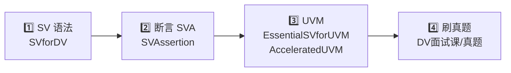

# SV-Playground

> 数字验证（Design Verification）自学路线：**SystemVerilog 语法 → 断言（SVA）→ UVM → 面试真题**

## 📖 学习路线

### 1️⃣ SystemVerilog 语法

从 [**SVforDV**](./SVforDV) 开始 —— Cadence 的基础 SV 语法课，有 PPT 和 LAB，LAB 里附 Solutions。

### 2️⃣ Assertion-Based Verification（SVA）

接着学断言，在 [**SVAssertion**](./SVAssertion) 里 —— 这是学 UVM 的基础。

### 3️⃣ UVM

| 资料 | 内容 |
| --- | --- |
| [**EssentialSVforUVM**](./EssentialSVforUVM) | PPT 讲解简单的 UVM 语法和框架 |
| [**AcceleratedUVM**](./AcceleratedUVM) | PPT + YAPP Router UVM 项目，从零搭建一个完整的 UVM 框架 |
| [**amba/uvm**](https://github.com/wkun-upenn/amba_project/tree/main/uvm) | 学完 YAPP 后的练手项目：给 AMBA AHB/APB 总线系统写一套模块级 + 系统级共用的 UVM 环境 |

> ⚠️ AcceleratedUVM 的 PPT 讲得比较抽象，很少解释原理。做这个项目之前，最好先把
> [**《UVM实战（卷Ⅰ）》**](./DV面试课/dv%20面试/book/582251%20UVM实战（卷Ⅰ%29.pdf)
> 看完 —— 这本书是理解 UVM 最好的途径。

### 4️⃣ 刷题

最后用 [**DV面试课/真题**](./DV面试课/真题) 里每一个月的真题练习。

## 📦 完整 UVM 项目一览

| 项目 | DUT | 简介 |
| --- | --- | --- |
| [**YAPP Router**](./AcceleratedUVM/uvma_training_1.2.6rev1/uvm/.solutions/lab11b_rm_integ) | Cadence YAPP 包路由器 | AcceleratedUVM 课程最终 lab：YAPP / Channel / HBUS / Clock&Reset 四个 UVC + 多通道 virtual sequencer + scoreboard + 寄存器模型（RAL）集成。各阶段 lab 见 [`.solutions`](./AcceleratedUVM/uvma_training_1.2.6rev1/uvm/.solutions) |
| [**AXI Full 2M3S**](./AXI_matrix_UVM/axi_full_2m3s_uvm_code) | AXI4-Full 2 主 3 从互连 | INCR burst、多 outstanding、乱序响应、WSTRB、DECERR；带参考存储器模型的 scoreboard、功能覆盖率，16 个 testcase（smoke / backpressure / deadlock stress 等），QuestaSim `run.do` 一键跑 |
| [**Systolic Array**](./PastProjects/TetraMem_HW/uvm) | 脉动阵列 + 双时钟 sub_sys | TetraMem 面试作业：模块级 `systolic_array` 与两时钟域 `sub_sys` 两级验证，共用 golden model / scoreboard，读写双 agent + virtual sequencer，signal 级与 transaction 级 covergroup，10 个 test。RTL 与纯 SV testbench 在[上一级目录](./PastProjects/TetraMem_HW) |
| [**BOOM Execute Pipeline**](./BOOM_RTL/uvm_exe) | Chipyard 生成的 BOOM v3 真实 RTL（ALU×2 / FPU / 整数发射队列 / CSRFile） | 乱序 RISC-V 执行流水线 block-level 验证：3 个参数化 exe agent + IQ agent + RAL（62 个 CSR）、50 条 SVA、27 个 covergroup、SoftFloat DPI-C 浮点参考模型 + Spike commit-log 回放，100 个 test / ~270 seed-run，VCS 覆盖率收敛。RTL 生成过程见 [BOOM_RTL](./BOOM_RTL) |
| [**AMBA AHB/APB 总线系统**](https://github.com/wkun-upenn/amba_project/tree/main/uvm) | AHB-lite + APB3 总线系统（AHB master / slave、AHB-APB bridge、多主 APB fabric，`AMBA_DUT` 整体集成） | 模块级 + 子系统级两个 testbench top 共用一个可配置 env：AHB / APB 各一套 master-slave-passive 三模式 agent，外加驱动 RTL master 命令口的 2 个 cmd agent；5 个 scoreboard（带参考存储器 + 地址映射的总线级数据一致性、bridge 逐 beat 对应 APB transfer、ERROR / PSLVERR 注入检查）+ monitor 协议断言 + 功能覆盖率，12 个 test，Verilator / VCS / Xcelium / Questa 四套 Makefile 流程。RTL 和纯 SV testbench 在 [amba](./amba)（submodule，源仓库 [amba_project](https://github.com/wkun-upenn/amba_project)） |
| [**BOOM Exe（行为模型版）**](./PastProjects/BOOM/boom_exe_uvm) | 自写的 BOOM 执行单元行为模型 | 上面项目的早期版本：DUT 是按 BOOM 文档写的行为模型，含 RV64 + IEEE-754 参考 scoreboard、CSR RAL、分支 speculation kill 检查，slang 严格 1800-2017 通过 |

> 💡 写新项目时可以直接套 [**UVM 环境模板**](./DV面试课/dv%20面试/template/coding.sv)（env / agent / virtual sequencer / RAL predictor 骨架）。
