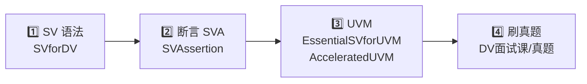

# SV-Playground

> 数字验证（Design Verification）自学路线：**SystemVerilog 语法 → 断言（SVA）→ UVM → 面试真题**

## 📖 学习路线

### 1️⃣ SystemVerilog 语法

从 [**SVforDV**](./SVforDV) 开始 —— Cadence 的基础 SV 语法课，有 PPT 和 LAB，LAB 里附 Solutions。

### 2️⃣ Assertion-Based Verification（SVA）

接着学断言，在 [**SVAssertion**](./SVAssertion) 里 —— 这是学 UVM 的基础。

### 3️⃣ UVM

| 资料 | 内容 |
| --- | --- |
| [**EssentialSVforUVM**](./EssentialSVforUVM) | PPT 讲解简单的 UVM 语法和框架 |
| [**AcceleratedUVM**](./AcceleratedUVM) | PPT + YAPP Router UVM 项目，从零搭建一个完整的 UVM 框架 |

> ⚠️ AcceleratedUVM 的 PPT 讲得比较抽象，很少解释原理。做这个项目之前，最好先把
> [**《UVM实战（卷Ⅰ）》**](./DV面试课/dv%20面试/book/582251%20UVM实战（卷Ⅰ%29.pdf)
> 看完 —— 这本书是理解 UVM 最好的途径。

### 4️⃣ 刷题

最后用 [**DV面试课/真题**](./DV面试课/真题) 里每一个月的真题练习。
